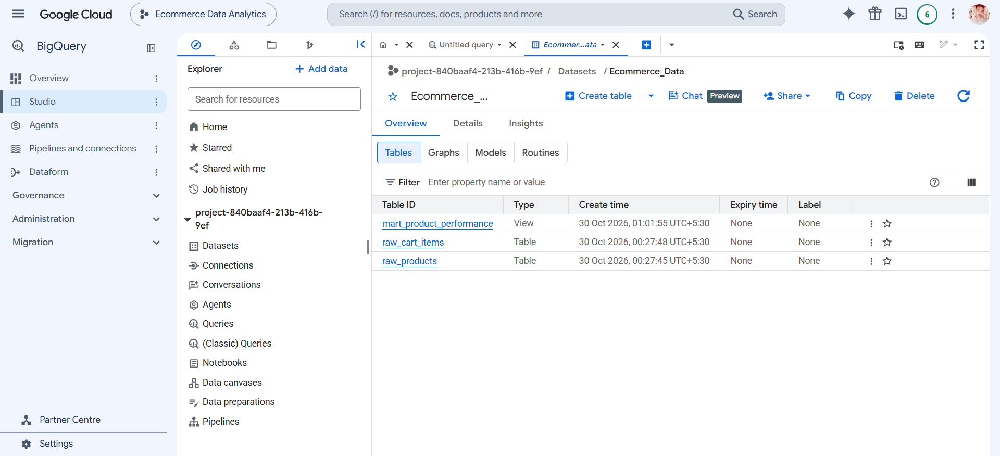
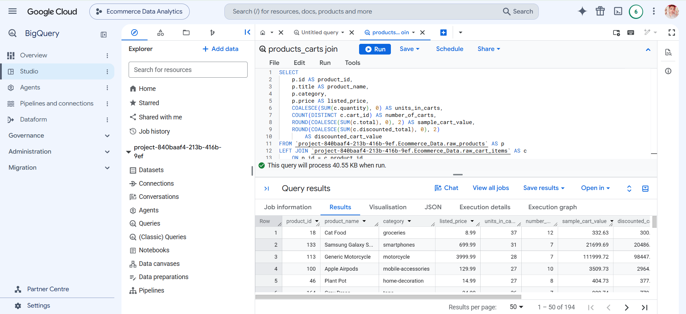
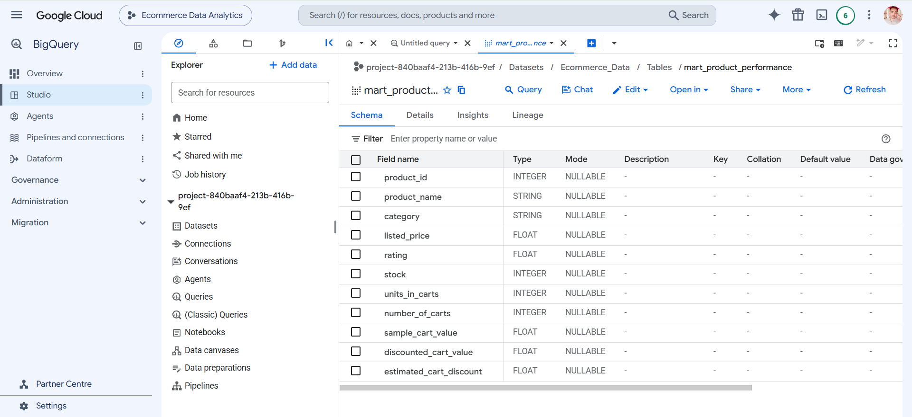

# Ecommerce Data Analytics: DummyJSON → BigQuery → Looker Studio

An end-to-end analytics pipeline on Google Cloud. A Python script ingests product and shopping-cart data from the public [DummyJSON](https://dummyjson.com) API into BigQuery, SQL models the raw tables into an analytics-ready view, and Looker Studio visualizes the results.

## Architecture

```
DummyJSON API ──► Python (requests) ──► BigQuery (raw tables) ──► BigQuery view (mart) ──► Looker Studio
 /products          api_to_bigquery.py    raw_products               mart_product_performance   dashboard
 /carts                                   raw_cart_items
```

### BigQuery Dataset and Raw Tables
Raw tables loaded by the ingestion script into the `Ecommerce_Data` dataset.



### Product and Cart Join
SQL join of product attributes with cart activity, the basis for the mart view.



### Mart View: `mart_product_performance`
Analytics-ready view consumed by Looker Studio.



## Tech Stack

| Layer | Tool |
|---|---|
| Source | DummyJSON REST API (`/products`, `/carts`) |
| Ingestion | Python 3, `requests`, `google-cloud-bigquery` |
| Warehouse | Google BigQuery |
| Visualization | Looker Studio |
| Development | VS Code (Windows), Git/GitHub |

## Data Model

**Raw layer** (loaded by the script, `WRITE_TRUNCATE` on each run):

| Table | Grain | Key columns |
|---|---|---|
| `raw_products` | One row per product | `id`, `title`, `category`, `price`, `discountPercentage`, `rating`, `stock`, `brand` |
| `raw_cart_items` | One row per product line in a cart (nested cart JSON flattened) | `cart_id`, `user_id`, `product_id`, `quantity`, `total`, `discounted_total` |

**Mart layer** (BigQuery view):

| View | Description |
|---|---|
| `mart_product_performance` | Product attributes (`category`, `listed_price`, `rating`, `stock`) joined with cart activity (`units_in_carts`, `number_of_carts`, `sample_cart_value`, `discounted_cart_value`, `estimated_cart_discount`). Products never added to a cart are kept via `LEFT JOIN` with zeroed metrics. |

## Prerequisites

- A Google Cloud project with the BigQuery API enabled
- A BigQuery dataset (this project uses `Ecommerce_Data`)
- Python 3.9+
- [Google Cloud CLI](https://cloud.google.com/sdk/docs/install) for local authentication

## Setup

```bash
# 1. Clone and enter the project
git clone <your-repo-url>
cd GCP/BigQuery

# 2. Create and activate a virtual environment
python -m venv venv
venv\Scripts\activate          # Windows
# source venv/bin/activate     # macOS / Linux

# 3. Install dependencies
pip install requests google-cloud-bigquery

# 4. Authenticate to Google Cloud
gcloud auth application-default login
```

Update the configuration at the top of `api_to_bigquery.py`:

```python
PROJECT_ID = "<your-gcp-project-id>"
DATASET_ID = "Ecommerce_Data"
```

## Run the Ingestion

```bash
python api_to_bigquery.py
```

Expected output:

```
raw_products: loaded <n> rows
raw_cart_items: loaded <n> rows
API ingestion completed successfully!
```

## Analysis Queries

After loading, `queries.sql` covers:

1. **Validation**: row counts for both raw tables
2. **Category summary**: product count, average price, and average rating per category
3. **Inventory**: top 10 products by stock
4. **Cart overview**: carts, unique users, units, cart value, and estimated discount
5. **Product-level join**: listed price vs. cart activity per product
6. **Mart view**: `CREATE OR REPLACE VIEW mart_product_performance`

## Looker Studio Dashboard

1. Open [Looker Studio](https://lookerstudio.google.com) and create a new report.
2. Add data → **BigQuery** → select your project → `Ecommerce_Data` → `mart_product_performance`.
3. Suggested visuals:
   - Scorecards: total products, units in carts, estimated cart discount
   - Bar chart: units in carts by category
   - Table: top products by `units_in_carts` with `rating` and `stock`
   - Scatter: `listed_price` vs. `units_in_carts`
   - Filter control: `category`