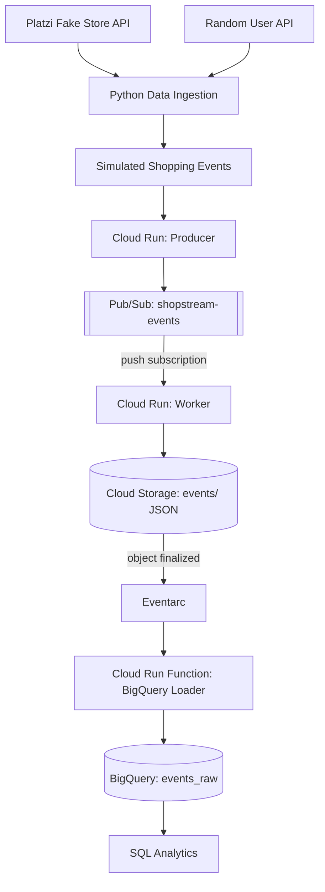
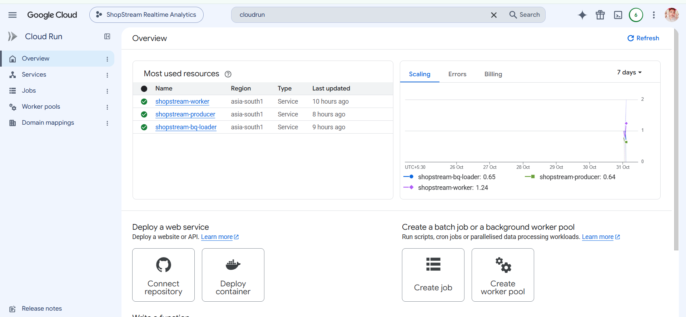
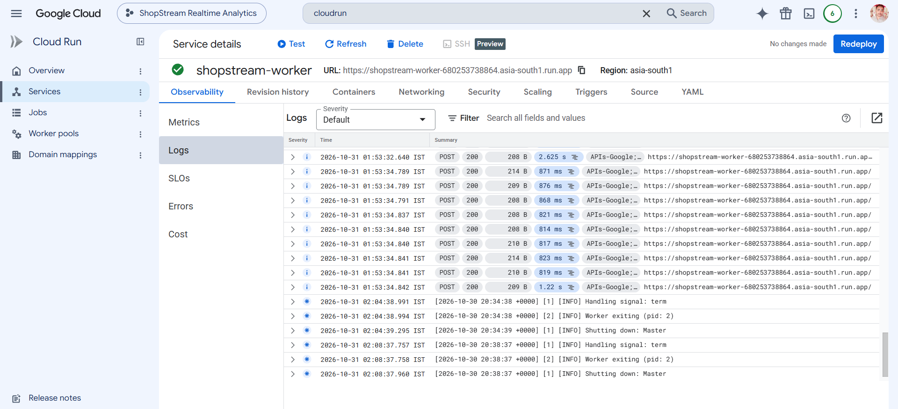
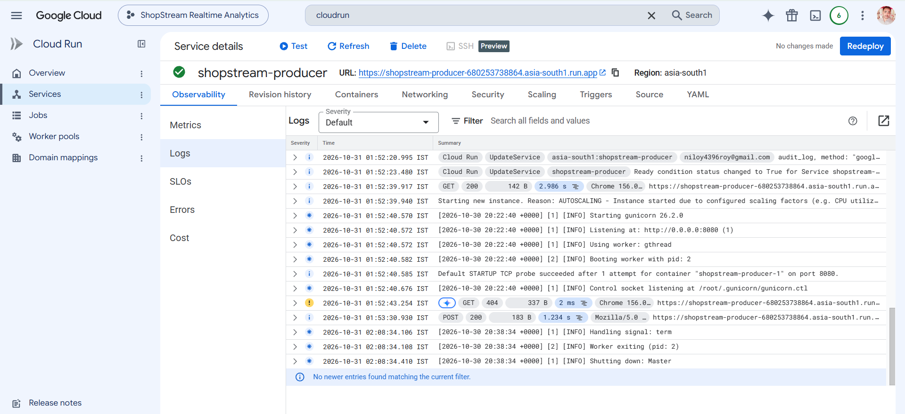
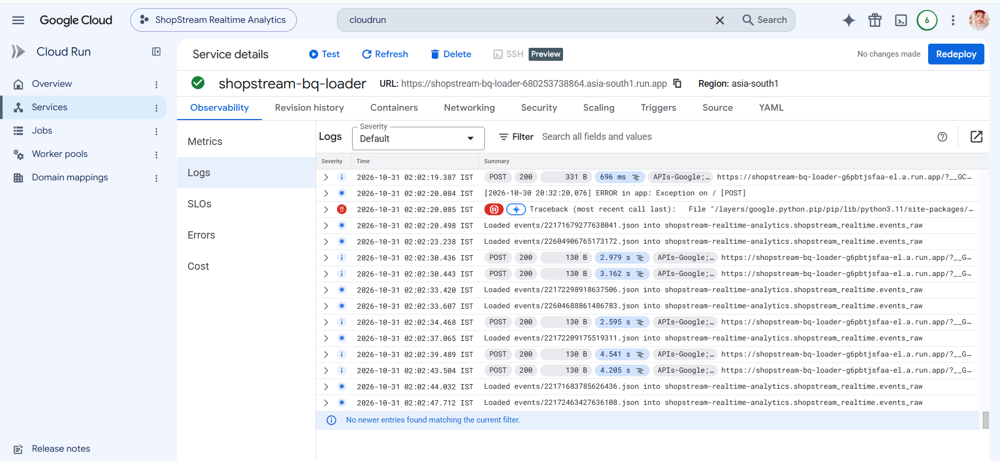
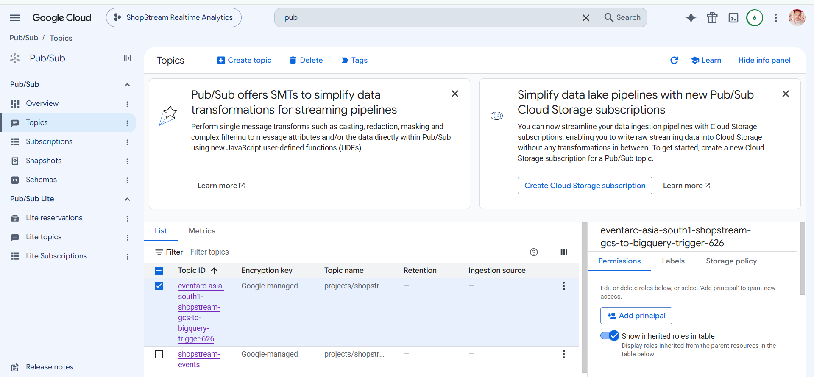
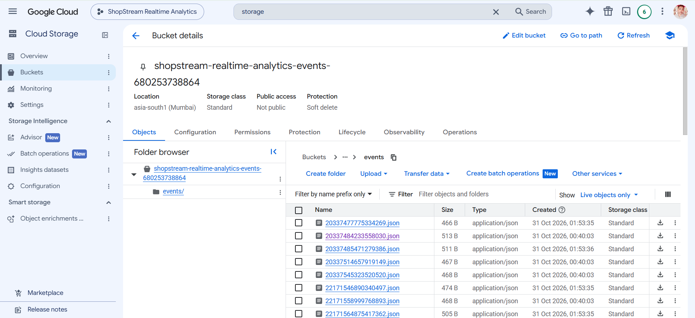
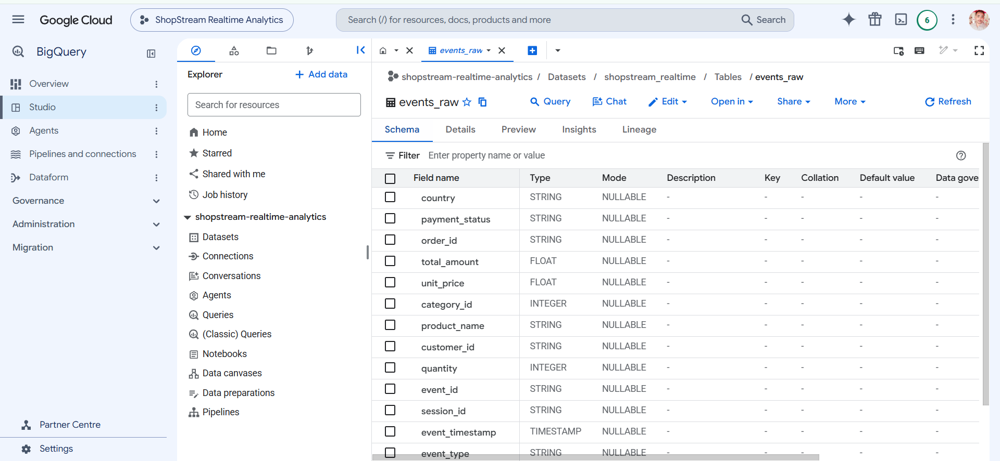
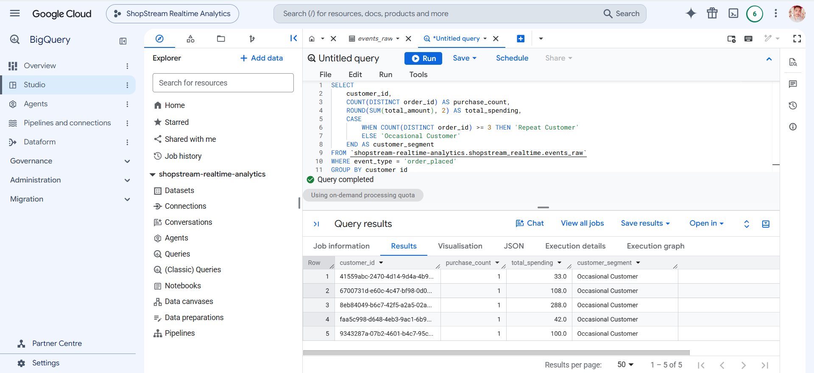
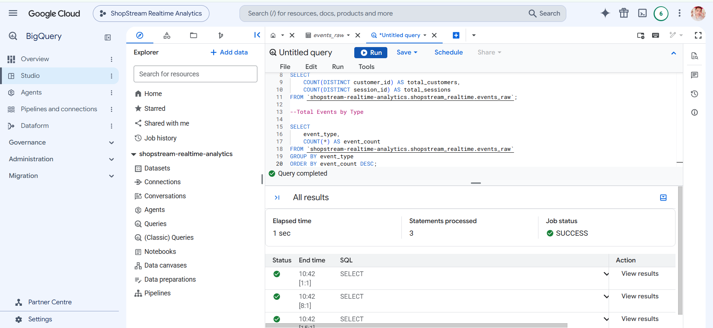

# 🛒 ShopStream: End-to-End Real-Time Analytics Pipeline on GCP


An **event-driven e-commerce analytics pipeline** on Google Cloud Platform. ShopStream simulates customer shopping activity, streams events through **Pub/Sub** and **Cloud Run**, lands them in **Cloud Storage**, and loads them into **BigQuery** for SQL-based business analytics.

> **Note:** Shopping activity is simulated with generated events. This is a learning and portfolio project demonstrating event-driven data engineering concepts, not a production e-commerce system.

---

## Table of Contents

- [Overview](#overview)
- [Architecture](#architecture)
- [Pipeline in Action](#pipeline-in-action)
- [Tech Stack](#tech-stack)
- [Data Sources](#data-sources)
- [Event Model](#event-model)
- [Pipeline Components](#pipeline-components)
- [BigQuery Analytics](#bigquery-analytics)
- [Project Structure](#project-structure)
- [Getting Started](#getting-started)
- [Key Learning Outcomes](#key-learning-outcomes)
- [Author](#author)

---

## Overview

E-commerce platforms generate large volumes of behavioral data: product views, cart additions, orders, and payments. Analyzing these events reveals customer behavior, sales performance, and conversion opportunities.

ShopStream demonstrates how to:

1. Collect product and customer data from public APIs
2. Generate realistic shopping sessions as events
3. Process them asynchronously with serverless GCP services
4. Persist raw events durably and load them into a warehouse
5. Answer business questions with SQL

---

## Architecture



---

## Pipeline in Action

Screenshots from the deployed pipeline, in the order events flow through it.

### Cloud Run Services






### Pub/Sub Topic



### Cloud Storage: Raw Event Files



### BigQuery: `events_raw` Table



### SQL Analytics Results




---

## Tech Stack

| Category | Technologies |
|---|---|
| Cloud Platform | Google Cloud Platform (GCP) |
| Data Sources | Platzi Fake Store API, Random User API |
| Language | Python |
| Messaging | Google Cloud Pub/Sub |
| Serverless Compute | Cloud Run, Cloud Run Functions |
| Object Storage | Google Cloud Storage |
| Event Routing | Eventarc |
| Data Warehouse | BigQuery |
| Analytics | SQL |
| Tooling | Visual Studio Code, Git, GitHub, Cloud Build |

---

## Data Sources

| Source | Provides |
|---|---|
| [Platzi Fake Store API](https://fakeapi.platzi.com/) | Product and category information |
| [Random User API](https://randomuser.me/) | Simulated customer profiles |

Retrieved data is saved locally as JSON and CSV files (`data/raw/`, `data/processed/`) before event generation.

---

## Event Model

The generator produces customer shopping sessions made up of four event types:

| Event | Description |
|---|---|
| `product_click` | Customer views a product |
| `add_to_cart` | Customer adds a product to the cart |
| `order_placed` | Customer places an order |
| `payment_completed` | Payment attempt is recorded |

Each event carries fields such as **customer ID, session ID, product ID, event timestamp, quantity, and payment status**.

Payment outcomes use **weighted probabilities**, so the dataset contains successful, failed, and pending payments, which makes the payment analysis meaningful.

---

## Pipeline Components

| # | Component | Role |
|---|---|---|
| 1 | **Cloud Run: Producer** | Generates shopping events and publishes them to Pub/Sub |
| 2 | **Pub/Sub** | The `shopstream-events` topic delivers messages to the Worker via a push subscription |
| 3 | **Cloud Run: Worker** | Receives messages and writes each payload as a JSON file to Cloud Storage |
| 4 | **Cloud Storage** | Durable landing zone for raw events under the `events/` prefix |
| 5 | **Eventarc** | Fires on finalized Cloud Storage objects and invokes the loader |
| 6 | **Cloud Run Function: Loader** | Reads new event files and appends them to the BigQuery raw table |
| 7 | **BigQuery** | Stores events in `shopstream_realtime.events_raw` for analysis |

---

## BigQuery Analytics

SQL scripts live in [`bigquery/`](bigquery/) and cover:

| Script | Analysis Area | Business Questions |
|---|---|---|
| `01_business_overview.sql` | Business Overview | How many events, customers, and sessions were generated? |
| `02_sales_revenue_analysis.sql` | Sales & Revenue | What are total order revenue and average order value? |
| `03_product_category_analysis.sql` | Product & Category Performance | Which products and categories generate the most revenue? |
| `04_customer_analysis.sql` | Customer Analysis | Who are the top customers, and how often do they purchase? |
| `05_payment_analysis.sql` | Payment Analysis | What are the payment statuses and success rates? |
| `06_customer_funnel_analysis.sql` | Customer Funnel | How do customers move from product click to order? |
| `07_geographic_analysis.sql` | Geographic Analysis | Which countries generate the most revenue? |

---

## Project Structure

```text
shopstream-realtime-analytics-gcp/
├── bigquery/                       # SQL analytics (7 scripts)
├── cloud_function/
│   ├── main.py                     # Eventarc-triggered BigQuery loader
│   └── requirements.txt
├── data/
│   ├── raw/                        # Data fetched from public APIs
│   └── processed/
├── ingestion/
│   ├── fetch_products.py
│   ├── fetch_categories.py
│   └── fetch_customers.py
├── producer/
│   ├── event_generator.py          # Session/event simulation
│   └── check_events.py             # Event validation
├── screenshots/                    # Images used in this README
├── worker/                         # Pub/Sub push-subscriber service
├── cloudbuild.yaml                 # Producer build config
├── cloudbuild-worker.yaml          # Worker build config
├── requirements.txt
└── README.md
```

---

## Getting Started

### Prerequisites

- A GCP project with billing enabled
- [Google Cloud CLI](https://cloud.google.com/sdk/docs/install) installed and authenticated
- Python 3.9+
- APIs enabled: Cloud Run, Pub/Sub, Cloud Storage, Eventarc, BigQuery, Cloud Build

### 1. Clone and install

```bash
git clone https://github.com/<your-username>/shopstream-realtime-analytics-gcp.git
cd shopstream-realtime-analytics-gcp
python -m venv venv && source venv/bin/activate
pip install -r requirements.txt
```

### 2. Fetch source data

```bash
python ingestion/fetch_products.py
python ingestion/fetch_categories.py
python ingestion/fetch_customers.py
```

### 3. Validate event generation locally

```bash
python producer/event_generator.py
python producer/check_events.py
```

### 4. Deploy to GCP

Create the Pub/Sub topic, Cloud Storage bucket, and BigQuery dataset/table, then build and deploy the services:

```bash
gcloud builds submit --config cloudbuild.yaml
gcloud builds submit --config cloudbuild-worker.yaml
```

Finally, deploy `cloud_function/` as a Cloud Run function with an Eventarc trigger on the bucket's *object finalized* event, and configure the `shopstream-events` push subscription to target the Worker service URL.

>
### 5. Run the analytics

Open the BigQuery console and run the scripts in `bigquery/` against `shopstream_realtime.events_raw`.

---

## Key Learning Outcomes

- Designing a cloud-based, event-driven data pipeline
- Ingesting data from public REST APIs with Python
- Generating and validating simulated event data
- Publishing and consuming messages with Pub/Sub
- Deploying serverless services on Cloud Run
- Landing raw data in Cloud Storage and triggering downstream work with Eventarc
- Loading JSON into BigQuery
- Writing SQL for business, customer, and funnel analytics
- Managing service accounts, IAM permissions, and cloud resources

---


## Author

**Niloy Roy**
Data Analytics | Python | SQL | Google Cloud Platform

[GitHub](https://github.com/CodesbyNiloy) · [LinkedIn](https://www.linkedin.com/in/niloy-roy-ab5961347/)


